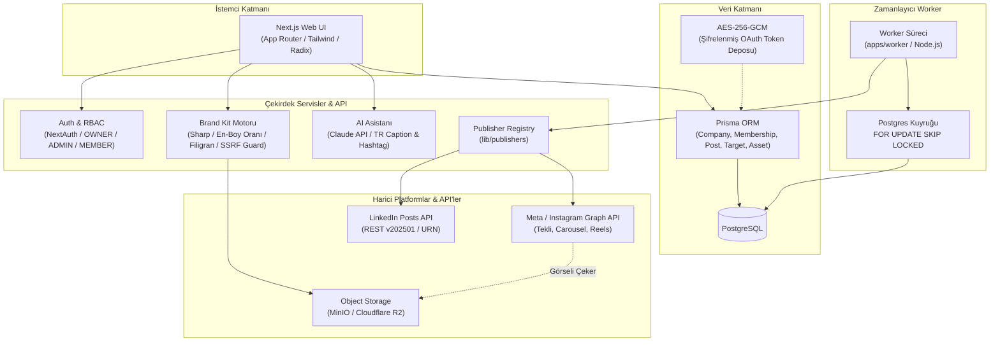

# Social Media Scheduler

Çok kiracılı (multi-tenant), rol tabanlı erişim kontrolüne (RBAC) sahip, Instagram ve LinkedIn platformlarına zamanlanmış ve doğrudan içerik yayınlayan kurumsal sosyal medya otomasyon platformu.

---

## 🏗️ Mimari Genel Bakış

Platform; Next.js App Router üzerinde koşan web arayüzü, bağımsız çalışan PostgreSQL kuyruk dinleyici worker süreci ve harici servis adaptörlerini tek bir Turborepo monorepo yapısında birleştirir.



---

## ✨ Temel Özellikler

### 1. Çok Kiracılı Mimari (Multi-Tenancy) & RBAC
- **Şirket İzolasyonu:** Her firma (`Company`) kendi sosyal medya hesaplarını, gönderilerini, varlıklarını ve Brand Kit şablonlarını izole şekilde barındırır.
- **Rol Tabanlı Erişim:** `MembershipRole` ile `OWNER`, `ADMIN` ve `MEMBER` seviyelerinde yetkilendirme. Gönderi onaylama (`PENDING_APPROVAL` → `SCHEDULED`), hesap bağlama ve API anahtarı yönetimi yönetici rollerine kilitlenmiştir.

### 2. Çoklu Platform Yayın Adaptörleri (Publisher Registry)
Çekirdek mimariye dokunmadan yeni platformlar eklenebilen tekil `Publisher` arayüzü:
- **Instagram Graph API Adaptörü:**
  - Tek görsel: Media container oluşturma ve publish akışı.
  - Carousel: Çoklu görsel için alt container'lar, birleşik carousel container ve yayınlama.
  - Reels: Asenkron video container (`media_type=REELS`) ve işlenme durumunu yoklayan polling mekanizması.
- **LinkedIn Adaptörü:**
  - LinkedIn REST Posts API (`202501` sürümü) entegrasyonu.
  - URN formatı çözümleme (`urn:li:organization:` / `urn:li:person:`).
  - API rate limit (429) durumunda `Retry-After` süresi okuma ve kontrollü hata yönetimi.

### 3. Dayanıklı Background Worker & Zamanlayıcı
- Next.js API sınırlarına takılmayan, arka planda çalışan bağımsız Node.js süreci (`apps/worker`).
- **Postgres `FOR UPDATE SKIP LOCKED`:** Zamanı gelmiş gönderiler veritabanı seviyesinde atomik kilitlenerek birden fazla worker'ın aynı kaydı mükerrer çekmesi kesin olarak engellenir.

### 4. Brand Kit Motoru (Sharp ile Otomatik Markalama)
- Ham görselleri platform standartlarına göre dinamik ölçeklendirme (1:1 kare, 4:5 dikey portre, 16:9 yatay).
- Şirket logosunu filigran (watermark) veya slim-bar olarak görsellere bindirme.
- **SSRF Koruması:** Dışarıdan gelen logo URL'leri `isStorageUrl` güvenlik süzgecinden geçirilerek yalnızca izin verilen güvenli depolama sunucularından çekilir.

### 5. AI Destekli İçerik Üretimi
- Anthropic Claude API entegrasyonu ile gönderi konusuna ve hedef kitleye uygun Türkçe başlık, metin ve hashtag önerileri.

### 6. Güvenlik ve Kriptografi
- **AES-256-GCM:** Sosyal medya erişim anahtarları (`accessTokenEncrypted`) ve platform client secret'ları veritabanında AES-256-GCM ile şifrelenir.
- **Zod & Ortam Doğrulaması:** `lib/env.ts` ile tüm ortam değişkenleri (`DATABASE_URL`, 32-byte `ENCRYPTION_KEY`, API anahtarları) uygulama ayağa kalkarken doğrulanır.
- **Parola Güvenliği:** bcrypt ile hash'leme ve API yanıtlarında hassas alanların dışarı sızmasını önleyen seçici sorgulama (`select`).

---

## 📦 Monorepo Yapısı

Turborepo ile yönetilen çalışma alanı:

```text
social-media-scheduler/
├── apps/
│   ├── frontend/        # Next.js 14 App Router, Tailwind CSS, Prisma şeması ve API rotaları
│   ├── worker/          # SKIP LOCKED ile çalışan bağımsız gönderi yayınlayıcı worker süreci
│   ├── admin-panel/     # Süper yönetici ve platform yönetim arayüzü
│   └── landing/         # Tanıtım ve karşılama sayfası
├── packages/
│   ├── ui/              # Paylaşılan UI bileşen kütüphanesi
│   ├── eslint-config/   # Monorepo geneli ESLint kuralları
│   └── typescript-config/# Ortak tsconfig profilleri
└── turbo.json           # Turborepo işlem boru hattı yapılandırması
```

---

## 🛠️ Teknoloji Yığını

| Katman | Teknolojiler |
| :--- | :--- |
| **Framework & Web** | Next.js 14 (App Router), React 18, Tailwind CSS, Radix UI |
| **Dil & Tip Denetimi** | TypeScript 5 (Strict Mode), Zod |
| **Veritabanı & ORM** | PostgreSQL, Prisma ORM |
| **Görsel İşleme** | Sharp |
| **Kriptografi & Güvenlik**| Node.js `crypto` (AES-256-GCM), bcryptjs, NextAuth.js |
| **Monorepo & Araçlar** | Turborepo, npm workspaces, Husky, lint-staged, ESLint |
| **Harici API'ler** | Meta Graph API (Instagram), LinkedIn REST API, Anthropic Claude API |

---

## 🚀 Kurulum ve Yerel Çalıştırma

### Gereksinimler
- Node.js: `>= 18.0.0`
- npm: `>= 10.0.0`
- PostgreSQL veritabanı

### 1. Bağımlılıkları Yükleyin
```bash
npm install
```

> **Git Hook Notu:** Kurulum sırasında `prepare` betiği Husky'yi başlatır. `git config core.hooksPath` değerinin `.husky` olduğunu teyit edin.

### 2. Ortam Değişkenlerini Tanımlayın
```bash
cd apps/frontend
cp .env.example .env
```
`.env` dosyasındaki değerleri kendi yerel yapılandırmanıza göre doldurun:
- `DATABASE_URL`: PostgreSQL bağlantı adresi
- `ENCRYPTION_KEY`: 32 byte uzunluğunda base64 anahtar (`openssl rand -base64 32`)
- `NEXTAUTH_SECRET`: Oturum imzalama anahtarı (`openssl rand -hex 32`)

### 3. Veritabanı Şemasını Eşitleyin
```bash
npx prisma db push
```

### 4. Geliştirme Ortamını Başlatın
Kök dizinde hem web sunucusunu hem de worker sürecini çalıştırın:

```bash
# Terminal 1: Web Arayüzü
npm run dev

# Terminal 2: Background Publisher Worker
npm run dev:worker
```

Uygulama varsayılan olarak `http://localhost:3000` portunda yayına başlar.
